# Comparação preliminar dos 14 veículos — Leilão SGGD/DMI 003/2026

Análise de 08/11/2026. **Triagem visual limitada: não é laudo nem recomendação definitiva de arrematação.**

## O que foi possível verificar

Foram examinadas as seis imagens disponíveis em cada uma das 14 galerias do catálogo Achalote: **84 imagens, todas com 320 × 240 pixels**. Elas têm marca da Sodré Santoro, mas são cópias reduzidas hospedadas pelo catálogo alternativo, não os arquivos originais em alta resolução. Não foi possível controlar o computador: o recurso não está habilitado nesta sessão. O endereço oficial consultado respondeu HTTP 403. Portanto, a navegação por Computer e a inspeção de todas as fotografias originais permanecem pendentes; não se presume que as seis imagens reproduzidas sejam a galeria oficial completa.

Cada galeria tem quatro vistas externas (F1–F4), uma vista superior do cofre (F5) e uma vista parcial do habitáculo dianteiro (F6). Não há vistas adequadas do assoalho inferior, alojamento do estepe, estrutura inferior, área de carga ou de todos os bancos. As observações abaixo se restringem aos pixels efetivamente disponíveis. O que não aparece não é considerado íntegro nem ausente.

Conferi os números de lote e as placas das descrições do catálogo com as linhas do Anexo I local. As placas físicas não são legíveis de forma suficiente nas fotos, frequentemente sem placa montada: a correspondência documental não é uma validação física de identidade. As descrições dos 14 veículos informam direito a documento e venda sem garantia. As linhas correspondentes do Anexo I não trazem avarias na coluna de observações; coluna vazia não significa veículo sem defeitos. Não foi feita consulta de débitos, restrições ou autenticidade em sistemas de trânsito.

## Correção do lote 522

O CSV apontava 522 e 468 para o mesmo identificador 2814270. No catálogo, **0522 = GBP5D07 = 2814317**, enquanto **0468 = FNE0H17 = 2814270**. O Anexo I confirma as placas diferentes. Corrigi somente o link do 522 no CSV original e salvei cópia anterior em `evidencias/carros_interesse_original.csv`. O endereço correto é https://leilao.sodresantoro.com.br/leilao/29109/lote/2814317/ . A associação foi confirmada documentalmente; a página oficial continua sem validação direta de conteúdo.

## Ranking para priorizar vistoria

A ordem combina completude visual aparente, desmontagens visíveis, relatos ainda pendentes do CSV e variedade de pontos a esclarecer. **Não é ranking de saúde mecânica, segurança estrutural ou custo-benefício comprovado.** Os valores do CSV não foram atualizados. A ordenação dentro de cada grupo tem confiança baixa e muda com a vistoria; nenhum veículo foi classificado como de baixo risco mecânico.

- **A:** começar por estes; pendências importantes ainda existem.
- **B:** vistoriar em seguida; há desmontagem, reposição ou maior complexidade a esclarecer.
- **C:** reduzir prioridade enquanto danos/desmontagens não forem esclarecidos.

| Ordem | Lote | Placa documental | Grupo | Motivo principal |
|---|---|---|---|---|
| 1 | 0123 | GAJ1C75 | A | Carroceria e interior relativamente completos nas vistas disponíveis. |
| 2 | 0522 | GBP5D07 | A | Alternativa visual aos primeiros colocados, com acabamentos a conferir. |
| 3 | 0463 | FPV3D79 | A | Conjunto visual razoavelmente completo; pendência de piso e acabamento do cofre. |
| 4 | 0468 | FNE0H17 | B | Danos em retrovisores e aberturas de painel aumentam a lista de reposição. |
| 5 | 0462 | FVH7J25 | B | Exterior relativamente completo, com desmontagem evidente na região do volante. |
| 6 | 0410 | EUL2I52 | B | Admissão aparentemente desconectada e alegação de impacto exigem cautela. |
| 7 | 0194 | FCN4414 | B | Preço anotado baixo acompanha interior desmontado e complexidade adicional do 4x4. |
| 8 | 0294 | FCK1215 | B | Frente com folgas e outro modelo exigem orçamento próprio. |
| 9 | 0556 | FYL0042 | B | Interior aberto e maior complexidade do 4x4; acabamento aparente não indica conservação mecânica. |
| 10 | 0324 | EMN8I06 | C | Relato de desmontagem não esclarecido pelas vistas disponíveis. |
| 11 | 0305 | FWI8C71 | C | Avaria dianteira visível; alcance do impacto desconhecido. |
| 12 | 0388 | FUZ6B24 | C | Dano dianteiro e desmontagem elétrica aparente elevam as pendências. |
| 13 | 0224 | FAQ1283 | C | Alegação de falta de embreagem exige esclarecimento antes de considerar compra. |
| 14 | 0097 | FVE3E24 | C | Conservação visual ruim e diversos acabamentos incompletos. |

Entre os seis lotes que você destacou, a ordem preliminar é **123 → 522 → 463 → 468 → 410 → 194**. Os dois relatos de furo de piso (123 e 463) podem rebaixá-los imediatamente se o exame permitido mostrar dano relevante ou se não houver esclarecimento suficiente para aceitar a incerteza.

## Edital: condições que mudam a vistoria e a compra

Fonte: arquivo local `Edital.pdf`, páginas 1–3 e 8, especialmente itens 1.1, 1.6, 1.8, 2.2 e 7.2. Leitura do documento fornecido; não foi verificada eventual retificação publicada posteriormente.

- Sessão prevista: **12/11/2026, das 10h às 16h**, horário de Brasília.
- Visitação sem agendamento: **10 e 11/11/2026, 9h–12h e 14h–17h**, Pátio Cesário Lange, Rodovia Presidente Castelo Branco, km 148, Aleluia dos Tavares, Cesário Lange/SP.
- **É proibido ligar motores, desmontar peças ou manusear veículos na visitação.** O edital informa remoção de combustível e baterias por segurança. Portanto, fotos com baterias não garantem sua presença na visita/entrega, e ausência de bateria isolada não prova pane.
- Venda no estado e sem garantia, inclusive em relação a peças inexistentes ou não originais. “Com direito a documento” não certifica condição de rodagem.
- Pagamento em até 48 horas da convocação, acrescido de **5% de comissão** e **R$ 22,89** para reconhecimento de firma dos veículos documentados. Transferência, transporte e demais despesas previstas no item 1.6 precisam entrar no orçamento.
- Para carros, caminhonetes e motocicletas, retirada prevista de **25/11 a 18/12/2026**, em dias úteis e com agendamento, conforme item 7.2.

A visita prevista não permite teste de partida, scanner, rodagem, compressão, desmontagem, acionamento de comandos ou levantamento/manuseio por conta própria. As recomendações abaixo significam observar o que estiver acessível e pedir ao responsável informações/fotos já disponíveis. Se uma verificação exigir acesso adicional, ela depende de autorização expressa do responsável; se não for permitida, a incerteza continua no preço e na decisão. Não basear o lance na promessa de que esses testes serão possíveis antes da compra.

## Comparação por lote

**Como ler:** “Observado” indica algo identificável na cópia reduzida, com limites explícitos. “Pendente/CSV” identifica relato não comprovado ou divergente. Causas de folgas, desmontagens e marcas são suspeitas, não diagnósticos. Nos 14 veículos, motor, embreagem, câmbio, sistemas eletrônicos, airbags, freios e integridade estrutural não foram validados.

### Lote 0123 — Renault Duster Zen 1.6 — 21/22 — GAJ1C75

**Grupo A. Carroceria e interior relativamente completos nas vistas disponíveis.** Valor anotado no CSV: R$ 17.500,00 (Lance atual; sem atualização). Mínimo do Anexo I: R$ 12,700.00 (página 3 do PDF local).

- **Observado, carroceria/impactos:** F1–F4: faróis, lanternas, para-choques e retrovisores aparecem instalados; marcas e resíduos nas laterais. O capô aparece ligeiramente elevado nas vistas dianteiras; isso não comprova deformação.
- **Observado, cofre:** F5: coletor, caixa de ar, duto principal e componente compatível com bateria aparecem instalados. Não há detalhe suficiente para certificar conexões, vazamentos ou fixações.
- **Observado, interior:** F6: volante, quadro de instrumentos, console central e alavanca aparecem presentes; o enquadramento não mostra integralmente bancos, piso ou traseira.
- **Pendente/CSV:** “Sem estepe” e “furo no assoalho” são relatos do CSV, sem comprovação nas seis fotos: não há vista do alojamento do estepe nem da parte inferior do piso.
- **Foco da vistoria:** Priorizar visualização do local exato do suposto furo, bordas, proximidade de ancoragens de bancos/cintos e corrosão, apenas se acessível sem manuseio. Solicitar ao responsável fotos adicionais do piso e do alojamento do estepe. O furo permanece uma pendência capaz de mudar totalmente a posição no ranking.

[Descrição e galeria consultadas](https://www.achalote.com/lote/sodresantoro/2813951) · [Endereço oficial referenciado](https://leilao.sodresantoro.com.br/leilao/29109/lote/2813951/)

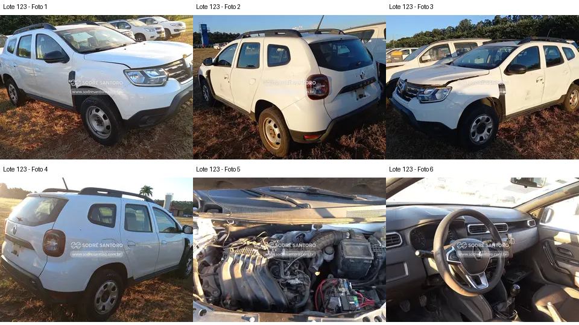

### Lote 0522 — Renault Duster Zen 1.6 — 20/21 — GBP5D07

**Grupo A. Alternativa visual aos primeiros colocados, com acabamentos a conferir.** Valor anotado no CSV: R$ 13.500,00 (Lance inicial; sem atualização). Mínimo do Anexo I: R$ 13,500.00 (página 11 do PDF local).

- **Observado, carroceria/impactos:** F1–F4: conjuntos ópticos e para-choques aparecem montados; há resíduos extensos de identificação nas laterais e tampa traseira e marcas no para-choque dianteiro.
- **Observado, cofre:** F5: coletor, caixa de ar e duto principal aparecem presentes; há bateria visível na fotografia. Folhas na região da base do para-brisa. Isso não informa o estado interno do motor.
- **Observado, interior:** F6: há uma abertura retangular no painel, à esquerda da região central inferior; console/controles centrais parecem incompletos. Não é possível inventariar precisamente as peças nem concluir sobre airbags.
- **Pendente/CSV:** “Banco rasgado” não fica demonstrado pelo recorte disponível. “Painel aberto” é parcialmente sustentado pela abertura visível, sem dimensionar toda a desmontagem.
- **Foco da vistoria:** Conferir placa GBP5D07 e lote 0522 antes de qualquer decisão. Pedir fotos frontais do painel e de todos os bancos. Inventariar molduras, comandos e conectores visíveis, verificar sinais de água e avaliar carroceria sob resíduos. Link corrigido e identidade documental conferida.

[Descrição e galeria consultadas](https://www.achalote.com/lote/sodresantoro/2814317) · [Endereço oficial referenciado](https://leilao.sodresantoro.com.br/leilao/29109/lote/2814317/)

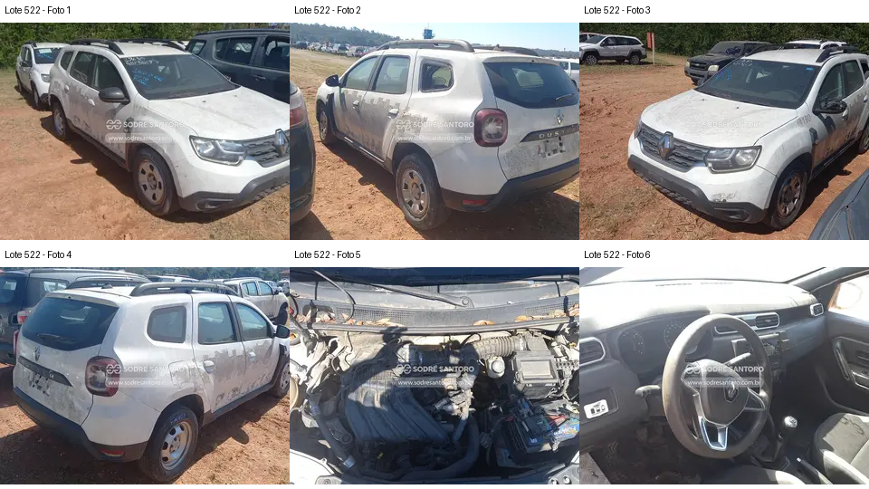

### Lote 0463 — Renault Duster Zen 1.6 — 20/21 — FPV3D79

**Grupo A. Conjunto visual razoavelmente completo; pendência de piso e acabamento do cofre.** Valor anotado no CSV: R$ 18.100,00 (Lance inicial; sem atualização). Mínimo do Anexo I: R$ 18,100.00 (página 10 do PDF local).

- **Observado, carroceria/impactos:** F1–F4: ópticas, para-choques e retrovisores aparecem instalados. Há resíduos extensos nas portas e traseira e capô parcialmente elevado nas fotos; não é prova de colisão.
- **Observado, cofre:** F5: coletor e duto superior aparecem presentes. A caixa de ar mostra região aberta/incompleta, que exige foto melhor. Na parte inferior direita há componente retangular com aspecto de bateria; a imagem não sustenta afirmar ausência na data da foto.
- **Observado, interior:** F6: volante, instrumentos, console central e alavanca aparecem presentes. Não há visão suficiente do piso nem dos bancos completos.
- **Pendente/CSV:** Furo no assoalho não é visível. “Sem bateria” do CSV diverge da aparência da foto; além disso, o edital prevê remoção de baterias para visitação. A presença em foto antiga não garante entrega com bateria.
- **Foco da vistoria:** Pedir foto detalhada da caixa de ar e do ponto referido como furo no piso; conferir se é passagem de equipamento, dano, corrosão ou outra abertura, sem antecipar a causa. Verificar visualmente o painel e assoalho acessível. Não tratar como candidato de baixo risco apenas pela aparência externa.

[Descrição e galeria consultadas](https://www.achalote.com/lote/sodresantoro/2814265) · [Endereço oficial referenciado](https://leilao.sodresantoro.com.br/leilao/29109/lote/2814265/)

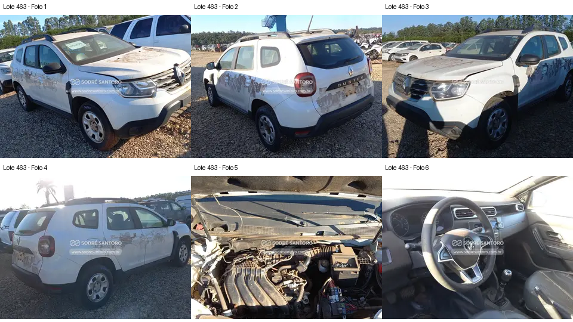

### Lote 0468 — Renault Duster Zen 1.6 — 20/21 — FNE0H17

**Grupo B. Danos em retrovisores e aberturas de painel aumentam a lista de reposição.** Valor anotado no CSV: R$ 12.900,00 (Lance inicial; sem atualização). Mínimo do Anexo I: R$ 12,900.00 (página 10 do PDF local).

- **Observado, carroceria/impactos:** F1 e F3: retrovisores aparecem danificados/incompletos, com partes expostas. F1–F4: painéis externos e ópticas principais aparecem presentes, com marcas/resíduos; capô parcialmente elevado.
- **Observado, cofre:** F5: coletor, tubulação de admissão e componente compatível com bateria são visíveis. Algumas caixas/áreas do cofre parecem abertas; não é possível definir inventário nem atribuir falha de motor.
- **Observado, interior:** F6: há abertura retangular no painel e componentes/fiação aparentes nessa região. O volante e a alavanca aparecem presentes.
- **Pendente/CSV:** Rasgo no banco não é confirmável neste recorte. “Painel com furos” deve ser discriminado entre abertura de acabamento/equipamento e perfuração real; a foto não resolve essa diferença em todos os pontos.
- **Foco da vistoria:** Orçar os conjuntos completos dos retrovisores e acabamentos apenas após inventário presencial permitido. Pedir fotos nítidas de bancos e painel; conferir presença de comandos e conectores sem tocar. Não concluir que airbags estão ausentes ou acionados pela abertura do painel.

[Descrição e galeria consultadas](https://www.achalote.com/lote/sodresantoro/2814270) · [Endereço oficial referenciado](https://leilao.sodresantoro.com.br/leilao/29109/lote/2814270/)

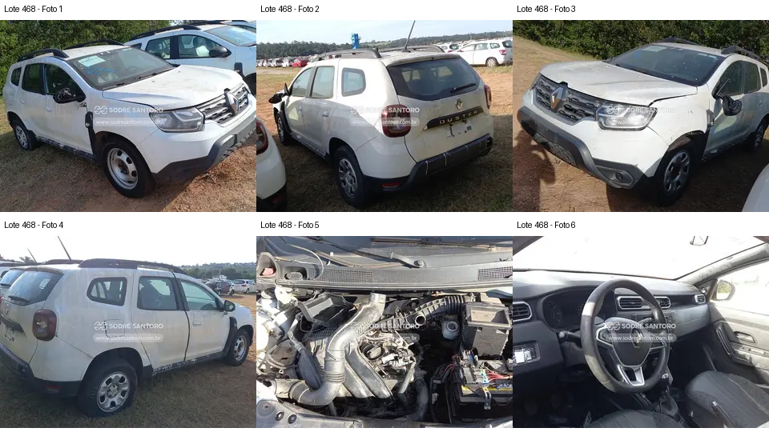

### Lote 0462 — Renault Duster Zen 1.6 — 20/21 — FVH7J25

**Grupo B. Exterior relativamente completo, com desmontagem evidente na região do volante.** Valor anotado no CSV: R$ 14.000,00 (Lance inicial; sem atualização). Mínimo do Anexo I: R$ 14,000.00 (página 10 do PDF local).

- **Observado, carroceria/impactos:** F1–F4: carroceria, conjuntos ópticos e para-choques aparecem montados; marcas/resíduos nas laterais. A foto não permite concluir ausência de para-lama metálico ou de revestimento da caixa de roda.
- **Observado, cofre:** F5: coletor e duto superior são visíveis; caixa de ar com região aberta e peça/tampa deslocada na área superior direita. Componente compatível com bateria aparece na parte inferior.
- **Observado, interior:** F6: acabamento/parte central do volante está deslocado e com região interna aparente. Não é possível concluir se o módulo de airbag foi removido ou acionado.
- **Pendente/CSV:** Rasgo de banco, falta de bateria e “sem paralama” do CSV precisam de confirmação específica. Distinguir para-lama externo de parabarro interno.
- **Foco da vistoria:** Priorizar foto nítida do volante e inventário do conjunto de segurança por profissional, dentro do acesso permitido. Pedir fotos da caixa de roda e bancos. A aparência externa favorável não resolve a dúvida sobre o volante.

[Descrição e galeria consultadas](https://www.achalote.com/lote/sodresantoro/2814264) · [Endereço oficial referenciado](https://leilao.sodresantoro.com.br/leilao/29109/lote/2814264/)

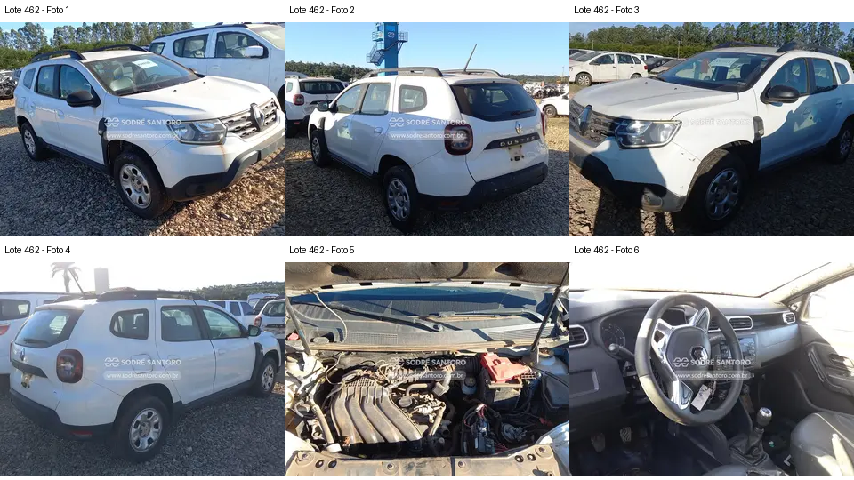

### Lote 0410 — Renault Duster Zen 1.6 — 20/21 — EUL2I52

**Grupo B. Admissão aparentemente desconectada e alegação de impacto exigem cautela.** Valor anotado no CSV: R$ 13.800,00 (Lance inicial; sem atualização). Mínimo do Anexo I: R$ 13,800.00 (página 9 do PDF local).

- **Observado, carroceria/impactos:** F1–F4: resíduos generalizados e marcas na carroceria; frente com capô parcialmente elevado. Não há elementos suficientes para qualificar uma colisão como “leve”.
- **Observado, cofre:** F5: há extremidade de tubulação aberta/desconectada na região dianteira esquerda da imagem. Coletor e parte da caixa de ar estão presentes; folhas/sujeira se acumulam na base do para-brisa. Estado interno e período de exposição são desconhecidos.
- **Observado, interior:** F6: volante, quadro de instrumentos e alavanca aparecem presentes, mas sombras impedem avaliar detalhes do console e do banco.
- **Pendente/CSV:** Ausência de estepe não é comprovada. A gravidade de “batida leve na frente” não pode ser validada. Tubulação fora de conexão é uma observação visual; contaminação interna é apenas possibilidade a investigar.
- **Foco da vistoria:** Pedir fotos próximas dos bocais e caminho da admissão; não tentar ligar o motor. Observar suportes dianteiros, fixações de faróis, folgas de capô e sinais de reparo acessíveis. Se não houver esclarecimento sobre a admissão aberta, manter reserva elevada para investigação posterior.

[Descrição e galeria consultadas](https://www.achalote.com/lote/sodresantoro/2814215) · [Endereço oficial referenciado](https://leilao.sodresantoro.com.br/leilao/29109/lote/2814215/)

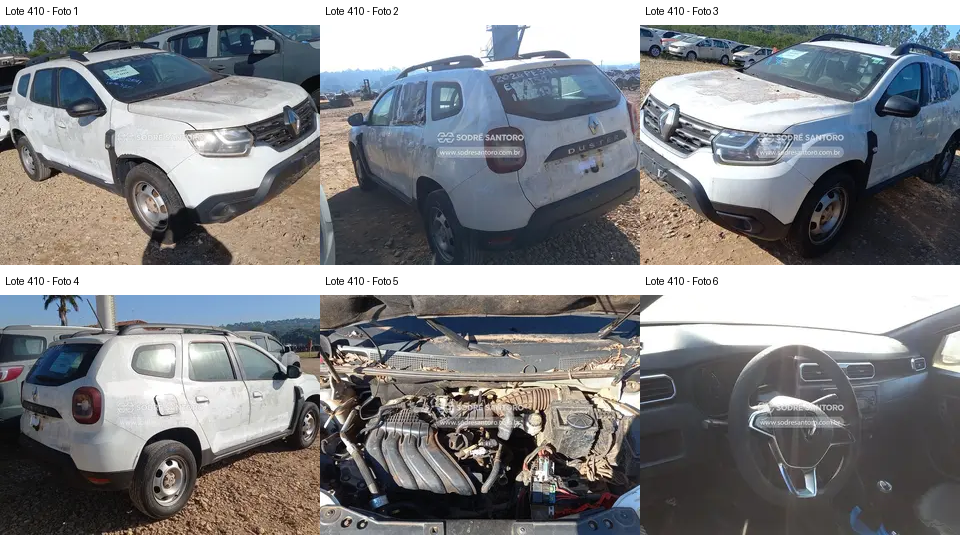

### Lote 0194 — Renault Duster 2.0 D 4x4 — 16/16 — FCN4414

**Grupo B. Preço anotado baixo acompanha interior desmontado e complexidade adicional do 4x4.** Valor anotado no CSV: R$ 8.900,00 (Lance atual; sem atualização). Mínimo do Anexo I: R$ 8,900.00 (página 4 do PDF local).

- **Observado, carroceria/impactos:** F1–F4: adesivação antiga, resíduos e desgaste aparente; ópticas e para-choques aparecem presentes. As fotos não demonstram dano estrutural.
- **Observado, cofre:** F5: coletor, caixa de ar e tubulação são visíveis, com sujeira intensa. Não é possível identificar seguramente todas as conexões nem validar bateria, periféricos ou estanqueidade.
- **Observado, interior:** F6: conjunto central do painel está aberto/deslocado, com componentes e fios aparentes na parte superior; volante e alavanca presentes.
- **Pendente/CSV:** O rasgo no banco anotado no CSV não pode ser delimitado pelo enquadramento. Não há demonstração do funcionamento da tração, caixa, embreagem ou diferenciais.
- **Foco da vistoria:** Inventariar visualmente painel e acabamentos e procurar sinais de instalação/remoção de equipamentos. Solicitar histórico e fotos inferiores existentes de cardã, diferencial traseiro e transmissão. Testes de tração e de rodagem não são possíveis na visita prevista pelo edital.

[Descrição e galeria consultadas](https://www.achalote.com/lote/sodresantoro/2814020) · [Endereço oficial referenciado](https://leilao.sodresantoro.com.br/leilao/29109/lote/2814020/)

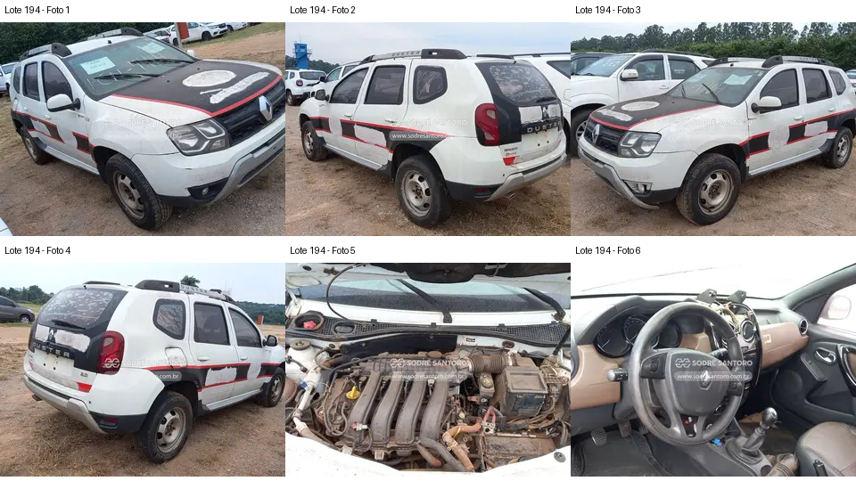

### Lote 0294 — Citroën Aircross M Feel — 16/17 — FCK1215

**Grupo B. Frente com folgas e outro modelo exigem orçamento próprio.** Valor anotado no CSV: R$ 14.700,00 (Lance atual; sem atualização). Mínimo do Anexo I: R$ 14,500.00 (página 7 do PDF local).

- **Observado, carroceria/impactos:** F1 e F3: folga/desalinhamento no encontro do para-choque dianteiro com a carroceria; resíduos e marcas externas. Na traseira, o suporte externo está sem roda sobressalente visível (F2/F4). Isso não prova ausência de qualquer estepe em outro local.
- **Observado, cofre:** F5: cobertura do motor e dutos aparecem presentes, com sujeira; a foto não permite comprovar bateria ausente nem problema de ignição.
- **Observado, interior:** F6: volante, instrumentos e painel central aparecem presentes; bancos e piso não estão integralmente enquadrados.
- **Pendente/CSV:** “Provável problema com vela” não é inferível pela foto e permanece alegação sem evidência técnica. Folga do para-choque pode decorrer de fixações, desmontagem ou impacto; a causa não foi comprovada.
- **Foco da vistoria:** Observar fixações, faróis, suportes e folgas dianteiras; pedir histórico de intervenção na ignição. Orçar peças específicas do Aircross separadamente dos Duster. Não atribuir falha de vela nem classificar colisão sem inspeção apropriada.

[Descrição e galeria consultadas](https://www.achalote.com/lote/sodresantoro/2814116) · [Endereço oficial referenciado](https://leilao.sodresantoro.com.br/leilao/29109/lote/2814116/)

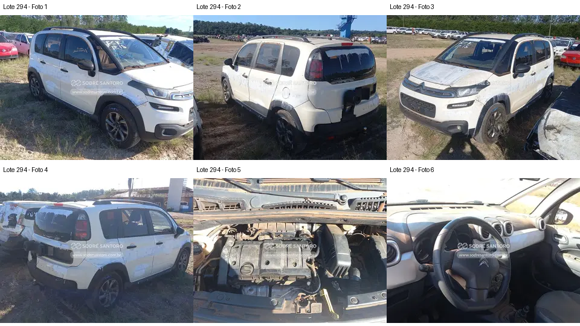

### Lote 0556 — Renault Duster 2.0 D 4x4 — 16/16 — FYL0042

**Grupo B. Interior aberto e maior complexidade do 4x4; acabamento aparente não indica conservação mecânica.** Valor anotado no CSV: R$ 15.100,00 (Lance inicial; sem atualização). Mínimo do Anexo I: R$ 15,100.00 (página 11 do PDF local).

- **Observado, carroceria/impactos:** F1–F4: adesivação e resíduos extensos; para-choques e ópticas presentes. A galeria não permite confirmar de modo seguro a falta de retrovisor indicada no CSV.
- **Observado, cofre:** F5: coletor e caixa de ar aparecem instalados, com sujeira. A parte inferior e o escapamento não estão fotografados.
- **Observado, interior:** F6: painel central aberto/desmontado e fiação aparente; revestimento em tom caramelo visível em parte do interior. Material do revestimento e estado completo dos bancos não são verificáveis.
- **Pendente/CSV:** Escapamento enferrujado é relato do CSV, sem imagem correspondente. Não há teste da tração 4x4 nem comprovação de saúde mecânica.
- **Foco da vistoria:** Conferir painel, retrovisores e bancos e pedir fotografias inferiores já disponíveis. Considerar orçamento específico de transmissão 4x4 e escapamento após verificação permitida. Não premiar o veículo apenas pelo revestimento aparente.

[Descrição e galeria consultadas](https://www.achalote.com/lote/sodresantoro/2814346) · [Endereço oficial referenciado](https://leilao.sodresantoro.com.br/leilao/29109/lote/2814346/)

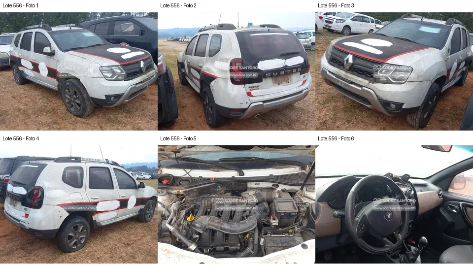

### Lote 0324 — Renault Duster Zen 1.6 — 21/22 — EMN8I06

**Grupo C. Relato de desmontagem não esclarecido pelas vistas disponíveis.** Valor anotado no CSV: R$ 18.100,00 (Lance inicial; sem atualização). Mínimo do Anexo I: R$ 18,100.00 (página 7 do PDF local).

- **Observado, carroceria/impactos:** F1–F4: resíduos nas laterais/tampa traseira; ópticas e para-choques presentes. Capô parcialmente elevado. Não há foto com porta aberta para confirmar desmontagem interna.
- **Observado, cofre:** F5: coletor e caixa de ar presentes; tubulações, conexões e região frontal precisam de fotos mais próximas. Aparência suja não comprova dano mecânico.
- **Observado, interior:** F6: volante, instrumentos e console central aparecem presentes, sem visão das faces internas de todas as portas.
- **Pendente/CSV:** “Motor partes desmontadas” e “porta desmontada” do CSV não têm extensão demonstrável nesta galeria; não é possível rejeitar nem validar integralmente o relato.
- **Foco da vistoria:** Pedir inventário escrito das peças removidas e imagens do cofre e da porta mencionada. Manter prioridade reduzida enquanto a desmontagem alegada permanecer sem esclarecimento, especialmente pelo valor anotado de R$ 18.100.

[Descrição e galeria consultadas](https://www.achalote.com/lote/sodresantoro/2814141) · [Endereço oficial referenciado](https://leilao.sodresantoro.com.br/leilao/29109/lote/2814141/)

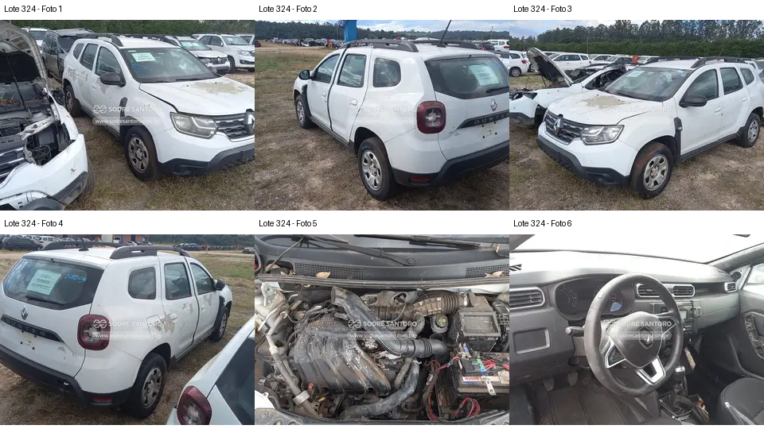

### Lote 0305 — Renault Duster Zen 1.6 — 21/22 — FWI8C71

**Grupo C. Avaria dianteira visível; alcance do impacto desconhecido.** Valor anotado no CSV: R$ 11.400,00 (Lance atual; sem atualização). Mínimo do Anexo I: R$ 11,400.00 (página 7 do PDF local).

- **Observado, carroceria/impactos:** F1/F3: para-choque dianteiro separado/desalinhado junto ao farol e para-lama; capô com folgas. Retrovisor aparece incompleto em vista lateral. F2/F4: resíduos na carroceria.
- **Observado, cofre:** F5: coletor, caixa de ar, tubulação principal e bateria aparecem presentes. Essa vista superior não exclui dano a radiador, suportes ou componentes inferiores.
- **Observado, interior:** F6: volante e console central presentes; há marcas nos bancos, sem resolução para classificar todo o desgaste.
- **Pendente/CSV:** A anotação de batida dianteira é compatível com as avarias visíveis; intensidade, direção e dano estrutural permanecem desconhecidos.
- **Foco da vistoria:** Priorizar comparação das folgas entre lados e observação de suportes, travessas acessíveis e fixações dos faróis. Pedir fotos próximas da região danificada e documentação de eventual reparo. Sem comprovação adicional, não assumir reparação limitada ao para-choque.

[Descrição e galeria consultadas](https://www.achalote.com/lote/sodresantoro/2814125) · [Endereço oficial referenciado](https://leilao.sodresantoro.com.br/leilao/29109/lote/2814125/)

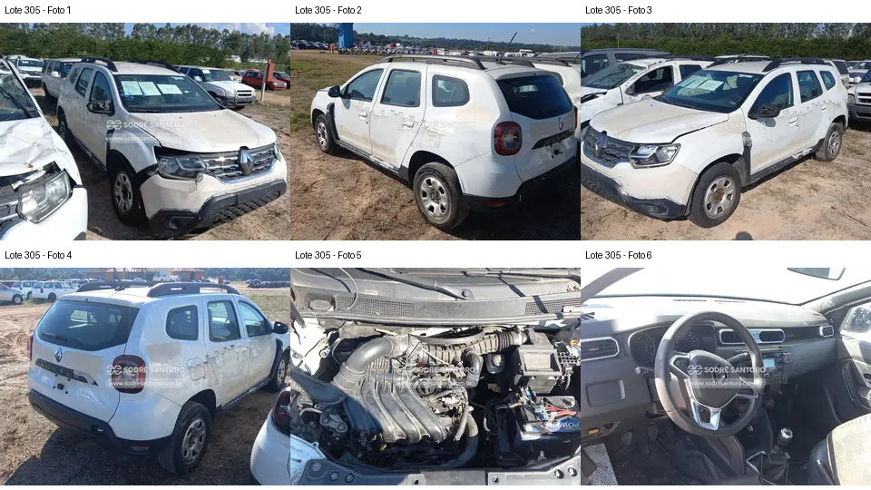

### Lote 0388 — Renault Duster Zen 1.6 — 20/21 — FUZ6B24

**Grupo C. Dano dianteiro e desmontagem elétrica aparente elevam as pendências.** Valor anotado no CSV: R$ 17.200,00 (Lance inicial; sem atualização). Mínimo do Anexo I: R$ 17,200.00 (página 8 do PDF local).

- **Observado, carroceria/impactos:** F1: para-choque separado/desalinhado junto ao farol de um lado; F1–F4: resíduos intensos nas superfícies.
- **Observado, cofre:** F5: folhas acumuladas e caixa/conjunto de admissão deslocado/aberto à direita da imagem; coletor presente. Não é possível avaliar ingresso de sujeira, corrosão interna ou causa da desmontagem.
- **Observado, interior:** F6: fiação exposta junto à parte inferior do painel/console; acabamento incompleto nessa região.
- **Pendente/CSV:** A falta de acabamento interno traseiro anotada no CSV não está mostrada, pois não há foto da área de carga. A extensão do impacto é desconhecida.
- **Foco da vistoria:** Pedir fotos da admissão, console e área de carga. Avaliar visualmente suportes dianteiros e inventariar componentes removidos. A soma de frente avariada e desmontagens torna menos atraente avançar sem esclarecimentos.

[Descrição e galeria consultadas](https://www.achalote.com/lote/sodresantoro/2814194) · [Endereço oficial referenciado](https://leilao.sodresantoro.com.br/leilao/29109/lote/2814194/)

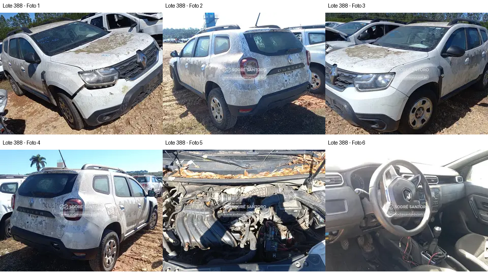

### Lote 0224 — Renault Duster EXP 1.6 SCe — 19/20 — FAQ1283

**Grupo C. Alegação de falta de embreagem exige esclarecimento antes de considerar compra.** Valor anotado no CSV: R$ 14.800,00 (Lance inicial; sem atualização). Mínimo do Anexo I: R$ 14,800.00 (página 5 do PDF local).

- **Observado, carroceria/impactos:** F1–F4: extensos resíduos/descascamentos superficiais aparentes; conjuntos ópticos e para-choques presentes. Não se consegue separar completamente dano de pintura e remoção de adesivos.
- **Observado, cofre:** F5: coletor de admissão e caixa de ar estão visíveis. Isso impede interpretar “sem admissão” como ausência de todo o coletor; conexões/trechos podem estar faltando ou desmontados, sem inventário seguro.
- **Observado, interior:** F6: volante, instrumentos e painel central aparecem presentes; banco do passageiro tem área clara irregular que pode ser dano de revestimento, sem caracterização segura nesta resolução.
- **Pendente/CSV:** Ausência de embreagem não é verificável pela foto superior do cofre. “Destruído” é avaliação do CSV e não um diagnóstico desta análise.
- **Foco da vistoria:** Solicitar confirmação escrita do que foi retirado da transmissão e admissão, com fotos existentes. Não presumir que bastará instalar um kit de embreagem. Enquanto não houver esclarecimento, manter entre as últimas opções.

[Descrição e galeria consultadas](https://www.achalote.com/lote/sodresantoro/2814049) · [Endereço oficial referenciado](https://leilao.sodresantoro.com.br/leilao/29109/lote/2814049/)

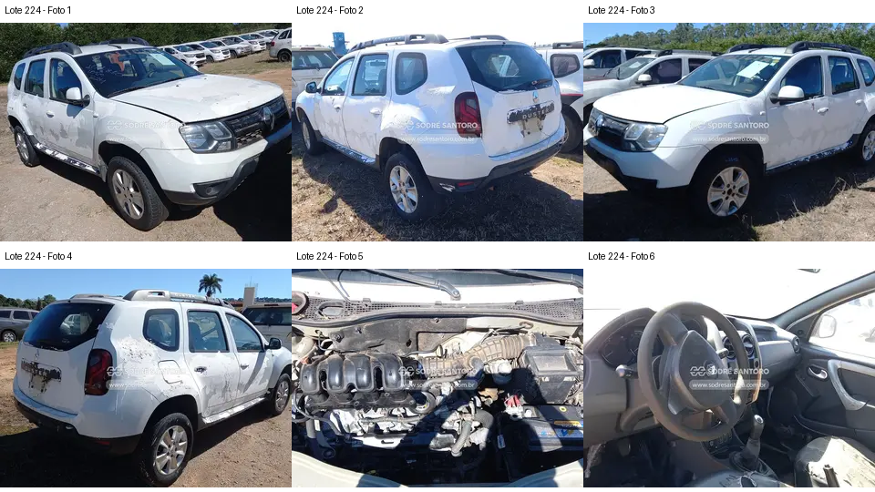

### Lote 0097 — Renault Duster 1.6 E 4x2 — 15/16 — FVE3E24

**Grupo C. Conservação visual ruim e diversos acabamentos incompletos.** Valor anotado no CSV: R$ 9.800,00 (Lance inicial; sem atualização). Mínimo do Anexo I: R$ 9,800.00 (página 2 do PDF local).

- **Observado, carroceria/impactos:** F1–F4: sujeira/manchas intensas, folgas no para-choque dianteiro junto ao farol (F3) e tampa traseira com acabamento na região da placa incompleto/danificado.
- **Observado, cofre:** F5: coletor e caixa de ar aparecem presentes; sujeira intensa. Não há base para avaliar funcionamento ou integridade interna.
- **Observado, interior:** F6: console central com abertura e peças/guarnições faltantes; parte inferior do painel incompleta; banco visível com desgaste e região de revestimento danificada.
- **Pendente/CSV:** “Destruída” é o termo do CSV; as fotos comprovam desgaste e desmontagem aparente, sem permitir concluir perda estrutural ou mecânica total.
- **Foco da vistoria:** Inventariar acabamento e painel, examinar áreas manchadas e folgas externas acessíveis e pedir histórico de armazenamento. Prioridade final para quem busca reduzir trabalho de recuperação; preço baixo isoladamente não compensa incerteza não quantificada.

[Descrição e galeria consultadas](https://www.achalote.com/lote/sodresantoro/2813929) · [Endereço oficial referenciado](https://leilao.sodresantoro.com.br/leilao/29109/lote/2813929/)

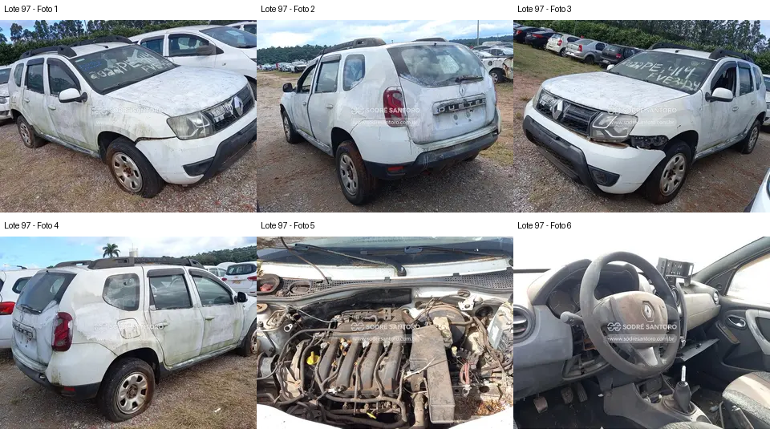

## Critérios para avançar ou retirar um lote da seleção

1. Levar ao pátio a lista de lote, placa e chassi da descrição e comparar com identificadores visíveis, sem manusear o carro. Divergência de identidade precisa ser resolvida antes de ofertar.
2. Nos lotes 123 e 463, localizar a evidência do suposto furo de piso. Sem visão suficiente, registrar “não avaliado”; não atribuir a corrosão, equipamento policial ou dano estrutural por suposição.
3. Nos 305, 388, 410 e 294, documentar folgas, fixações, peças quebradas e regiões acessíveis da frente. Se não for possível delimitar o reparo, não orçar somente pintura e para-choque.
4. Nos 194, 522, 468, 462, 556 e 97, pedir inventário de acabamentos, comandos e itens de segurança ausentes. Volante aberto não prova acionamento de airbag; painel aberto não prova módulo eletrônico faltante.
5. Nos 224 e 324, esclarecer por escrito quais partes de admissão/transmissão foram retiradas. Peça grande presente em foto não garante conjunto completo; alegação do CSV também não substitui inventário.
6. Para 194 e 556, o 4x4 exige verificação posterior específica de transmissão, cardã e diferenciais. A impossibilidade de testar deve ser aceita conscientemente antes da compra, sem prometer que o sistema funciona.
7. Preparar custo total com lance, comissão, taxas, transporte, documentação, componentes efetivamente faltantes e contingência para funcionamento desconhecido. Não foi fixado teto de lance: faltam inspeção permitida, valores atuais, histórico e orçamento verificável.

Se você precisa de um veículo pronto para uso ou não tolera reparos mecânicos de extensão desconhecida, a evidência disponível não sustenta recomendar a arrematação de nenhum destes carros. Para continuar a triagem, começaria pelos três do grupo A, levando profissional para a observação permitida, e só avançaria após resolver os pontos que puderem ser esclarecidos.

## Rastreabilidade e pendências

A pasta `evidencias` contém as 84 imagens reduzidas, 14 montagens numeradas, descrições, páginas HTML recuperadas e URLs das imagens em `fontes.json` por lote. `carros_conferencia.csv` reúne placas, links e valores do Anexo I. Nenhuma avaliação foi baseada em fotos de veículos semelhantes. Não há prova de funcionamento, quilometragem real, ausência de sinistro, integridade de longarinas, airbags operacionais ou inexistência de corrosão oculta.

**Pendências para cumprir integralmente o pedido original:** acesso por Computer habilitado; abertura das páginas oficiais; inspeção de todas as imagens originais em resolução suficiente; conferência de eventuais imagens adicionais, atualizações e retificações; confronto físico de placas/identificadores. O relatório entrega a triagem possível agora e não declara concluída essa parte indisponível.
