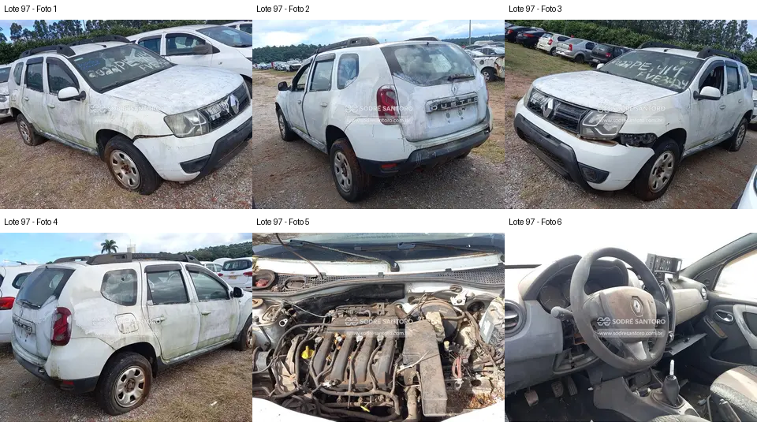

# Lote 0097 — edital 003/2026

Atualizado em: 2026-11-08. Classificação: hipótese/análise histórica e fatos voláteis do catálogo.
Fonte: comparacao_preliminar_carros.md, seção “Lote 0097”, linha 257; carros_conferencia.csv, registro Lote 0097.
Confiança: baixa para priorização/estado mecânico; conferência documental anterior não refeita integralmente.
Revalidar em: próxima consulta ao catálogo, antes da visita e antes de qualquer lance.
Veredito: grupo C de prioridade de vistoria; nenhuma aprovação de compra.
Custo total: não verificado. Valores abaixo são registros históricos, não cotação atual nem teto de lance.
Evidências: [galeria](../evidencias/97/galeria.png), [origens](../evidencias/97/fontes.json), [descrição](../evidencias/97/descricao.json).
Anexo I: [fonte](../fontes/md/Carros_lista.md), p. 2; conferir identidade no original.

## Análise anterior preservada

### Lote 0097 — Renault Duster 1.6 E 4x2 — 15/16 — FVE3E24

**Grupo C. Conservação visual ruim e diversos acabamentos incompletos.** Valor anotado no CSV: R$ 9.800,00 (Lance inicial; sem atualização). Mínimo do Anexo I: R$ 9,800.00 (página 2 do PDF local).

- **Observado, carroceria/impactos:** F1–F4: sujeira/manchas intensas, folgas no para-choque dianteiro junto ao farol (F3) e tampa traseira com acabamento na região da placa incompleto/danificado.
- **Observado, cofre:** F5: coletor e caixa de ar aparecem presentes; sujeira intensa. Não há base para avaliar funcionamento ou integridade interna.
- **Observado, interior:** F6: console central com abertura e peças/guarnições faltantes; parte inferior do painel incompleta; banco visível com desgaste e região de revestimento danificada.
- **Pendente/CSV:** “Destruída” é o termo do CSV; as fotos comprovam desgaste e desmontagem aparente, sem permitir concluir perda estrutural ou mecânica total.
- **Foco da vistoria:** Inventariar acabamento e painel, examinar áreas manchadas e folgas externas acessíveis e pedir histórico de armazenamento. Prioridade final para quem busca reduzir trabalho de recuperação; preço baixo isoladamente não compensa incerteza não quantificada.

[Descrição e galeria consultadas](https://www.achalote.com/lote/sodresantoro/2813929) · [Endereço oficial referenciado](https://leilao.sodresantoro.com.br/leilao/29109/lote/2813929/)

## Próxima verificação
Confirmar identidade, documentação, condição observável e orçamento de reparos; atualizar apenas com fonte e data. Relatos do CSV não são diagnósticos. Não presumir testes de motor/manuseio permitidos.
