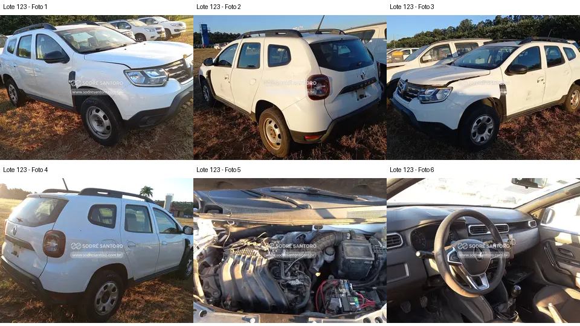

# Lote 0123 — edital 003/2026

Atualizado em: 2026-11-08. Classificação: hipótese/análise histórica e fatos voláteis do catálogo.
Fonte: comparacao_preliminar_carros.md, seção “Lote 0123”, linha 62; carros_conferencia.csv, registro Lote 0123.
Confiança: baixa para priorização/estado mecânico; conferência documental anterior não refeita integralmente.
Revalidar em: próxima consulta ao catálogo, antes da visita e antes de qualquer lance.
Veredito: grupo A de prioridade de vistoria; nenhuma aprovação de compra.
Custo total: não verificado. Valores abaixo são registros históricos, não cotação atual nem teto de lance.
Evidências: [galeria](../evidencias/123/galeria.png), [origens](../evidencias/123/fontes.json), [descrição](../evidencias/123/descricao.json).
Anexo I: [fonte](../fontes/md/Carros_lista.md), p. 3; conferir identidade no original.

## Análise anterior preservada

### Lote 0123 — Renault Duster Zen 1.6 — 21/22 — GAJ1C75

**Grupo A. Carroceria e interior relativamente completos nas vistas disponíveis.** Valor anotado no CSV: R$ 17.500,00 (Lance atual; sem atualização). Mínimo do Anexo I: R$ 12,700.00 (página 3 do PDF local).

- **Observado, carroceria/impactos:** F1–F4: faróis, lanternas, para-choques e retrovisores aparecem instalados; marcas e resíduos nas laterais. O capô aparece ligeiramente elevado nas vistas dianteiras; isso não comprova deformação.
- **Observado, cofre:** F5: coletor, caixa de ar, duto principal e componente compatível com bateria aparecem instalados. Não há detalhe suficiente para certificar conexões, vazamentos ou fixações.
- **Observado, interior:** F6: volante, quadro de instrumentos, console central e alavanca aparecem presentes; o enquadramento não mostra integralmente bancos, piso ou traseira.
- **Pendente/CSV:** “Sem estepe” e “furo no assoalho” são relatos do CSV, sem comprovação nas seis fotos: não há vista do alojamento do estepe nem da parte inferior do piso.
- **Foco da vistoria:** Priorizar visualização do local exato do suposto furo, bordas, proximidade de ancoragens de bancos/cintos e corrosão, apenas se acessível sem manuseio. Solicitar ao responsável fotos adicionais do piso e do alojamento do estepe. O furo permanece uma pendência capaz de mudar totalmente a posição no ranking.

[Descrição e galeria consultadas](https://www.achalote.com/lote/sodresantoro/2813951) · [Endereço oficial referenciado](https://leilao.sodresantoro.com.br/leilao/29109/lote/2813951/)

## Próxima verificação
Confirmar identidade, documentação, condição observável e orçamento de reparos; atualizar apenas com fonte e data. Relatos do CSV não são diagnósticos. Não presumir testes de motor/manuseio permitidos.
