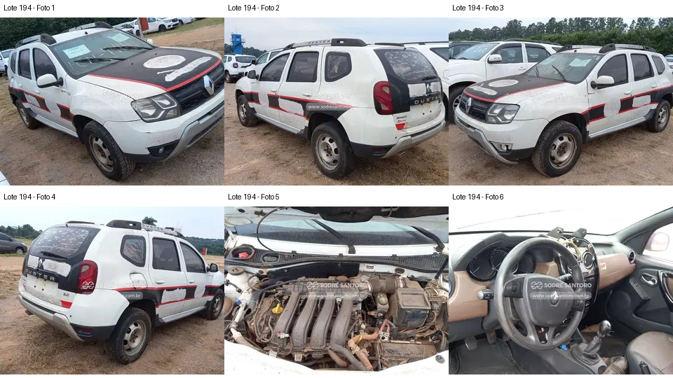

# Lote 0194 — edital 003/2026

Atualizado em: 2026-11-08. Classificação: hipótese/análise histórica e fatos voláteis do catálogo.
Fonte: comparacao_preliminar_carros.md, seção “Lote 0194”, linha 152; carros_conferencia.csv, registro Lote 0194.
Confiança: baixa para priorização/estado mecânico; conferência documental anterior não refeita integralmente.
Revalidar em: próxima consulta ao catálogo, antes da visita e antes de qualquer lance.
Veredito: grupo B de prioridade de vistoria; nenhuma aprovação de compra.
Custo total: não verificado. Valores abaixo são registros históricos, não cotação atual nem teto de lance.
Evidências: [galeria](../evidencias/194/galeria.png), [origens](../evidencias/194/fontes.json), [descrição](../evidencias/194/descricao.json).
Anexo I: [fonte](../fontes/md/Carros_lista.md), p. 4; conferir identidade no original.

## Análise anterior preservada

### Lote 0194 — Renault Duster 2.0 D 4x4 — 16/16 — FCN4414

**Grupo B. Preço anotado baixo acompanha interior desmontado e complexidade adicional do 4x4.** Valor anotado no CSV: R$ 8.900,00 (Lance atual; sem atualização). Mínimo do Anexo I: R$ 8,900.00 (página 4 do PDF local).

- **Observado, carroceria/impactos:** F1–F4: adesivação antiga, resíduos e desgaste aparente; ópticas e para-choques aparecem presentes. As fotos não demonstram dano estrutural.
- **Observado, cofre:** F5: coletor, caixa de ar e tubulação são visíveis, com sujeira intensa. Não é possível identificar seguramente todas as conexões nem validar bateria, periféricos ou estanqueidade.
- **Observado, interior:** F6: conjunto central do painel está aberto/deslocado, com componentes e fios aparentes na parte superior; volante e alavanca presentes.
- **Pendente/CSV:** O rasgo no banco anotado no CSV não pode ser delimitado pelo enquadramento. Não há demonstração do funcionamento da tração, caixa, embreagem ou diferenciais.
- **Foco da vistoria:** Inventariar visualmente painel e acabamentos e procurar sinais de instalação/remoção de equipamentos. Solicitar histórico e fotos inferiores existentes de cardã, diferencial traseiro e transmissão. Testes de tração e de rodagem não são possíveis na visita prevista pelo edital.

[Descrição e galeria consultadas](https://www.achalote.com/lote/sodresantoro/2814020) · [Endereço oficial referenciado](https://leilao.sodresantoro.com.br/leilao/29109/lote/2814020/)

## Próxima verificação
Confirmar identidade, documentação, condição observável e orçamento de reparos; atualizar apenas com fonte e data. Relatos do CSV não são diagnósticos. Não presumir testes de motor/manuseio permitidos.
