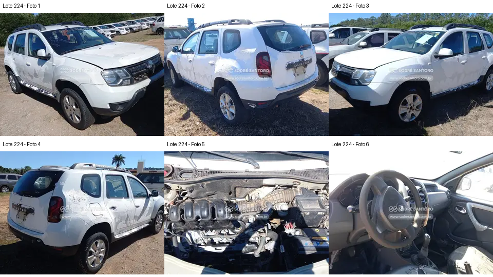

# Lote 0224 — edital 003/2026

Atualizado em: 2026-11-08. Classificação: hipótese/análise histórica e fatos voláteis do catálogo.
Fonte: comparacao_preliminar_carros.md, seção “Lote 0224”, linha 242; carros_conferencia.csv, registro Lote 0224.
Confiança: baixa para priorização/estado mecânico; conferência documental anterior não refeita integralmente.
Revalidar em: próxima consulta ao catálogo, antes da visita e antes de qualquer lance.
Veredito: grupo C de prioridade de vistoria; nenhuma aprovação de compra.
Custo total: não verificado. Valores abaixo são registros históricos, não cotação atual nem teto de lance.
Evidências: [galeria](../evidencias/224/galeria.png), [origens](../evidencias/224/fontes.json), [descrição](../evidencias/224/descricao.json).
Anexo I: [fonte](../fontes/md/Carros_lista.md), p. 5; conferir identidade no original.

## Análise anterior preservada

### Lote 0224 — Renault Duster EXP 1.6 SCe — 19/20 — FAQ1283

**Grupo C. Alegação de falta de embreagem exige esclarecimento antes de considerar compra.** Valor anotado no CSV: R$ 14.800,00 (Lance inicial; sem atualização). Mínimo do Anexo I: R$ 14,800.00 (página 5 do PDF local).

- **Observado, carroceria/impactos:** F1–F4: extensos resíduos/descascamentos superficiais aparentes; conjuntos ópticos e para-choques presentes. Não se consegue separar completamente dano de pintura e remoção de adesivos.
- **Observado, cofre:** F5: coletor de admissão e caixa de ar estão visíveis. Isso impede interpretar “sem admissão” como ausência de todo o coletor; conexões/trechos podem estar faltando ou desmontados, sem inventário seguro.
- **Observado, interior:** F6: volante, instrumentos e painel central aparecem presentes; banco do passageiro tem área clara irregular que pode ser dano de revestimento, sem caracterização segura nesta resolução.
- **Pendente/CSV:** Ausência de embreagem não é verificável pela foto superior do cofre. “Destruído” é avaliação do CSV e não um diagnóstico desta análise.
- **Foco da vistoria:** Solicitar confirmação escrita do que foi retirado da transmissão e admissão, com fotos existentes. Não presumir que bastará instalar um kit de embreagem. Enquanto não houver esclarecimento, manter entre as últimas opções.

[Descrição e galeria consultadas](https://www.achalote.com/lote/sodresantoro/2814049) · [Endereço oficial referenciado](https://leilao.sodresantoro.com.br/leilao/29109/lote/2814049/)

## Próxima verificação
Confirmar identidade, documentação, condição observável e orçamento de reparos; atualizar apenas com fonte e data. Relatos do CSV não são diagnósticos. Não presumir testes de motor/manuseio permitidos.
