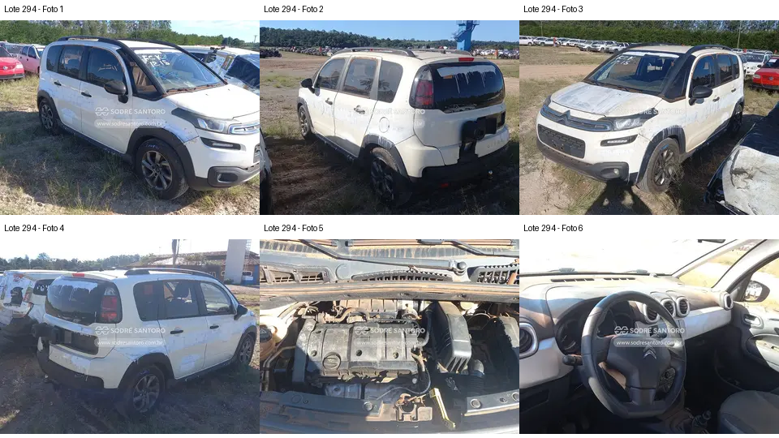

# Lote 0294 — edital 003/2026

Atualizado em: 2026-11-08. Classificação: hipótese/análise histórica e fatos voláteis do catálogo.
Fonte: comparacao_preliminar_carros.md, seção “Lote 0294”, linha 167; carros_conferencia.csv, registro Lote 0294.
Confiança: baixa para priorização/estado mecânico; conferência documental anterior não refeita integralmente.
Revalidar em: próxima consulta ao catálogo, antes da visita e antes de qualquer lance.
Veredito: grupo B de prioridade de vistoria; nenhuma aprovação de compra.
Custo total: não verificado. Valores abaixo são registros históricos, não cotação atual nem teto de lance.
Evidências: [galeria](../evidencias/294/galeria.png), [origens](../evidencias/294/fontes.json), [descrição](../evidencias/294/descricao.json).
Anexo I: [fonte](../fontes/md/Carros_lista.md), p. 7; conferir identidade no original.

## Análise anterior preservada

### Lote 0294 — Citroën Aircross M Feel — 16/17 — FCK1215

**Grupo B. Frente com folgas e outro modelo exigem orçamento próprio.** Valor anotado no CSV: R$ 14.700,00 (Lance atual; sem atualização). Mínimo do Anexo I: R$ 14,500.00 (página 7 do PDF local).

- **Observado, carroceria/impactos:** F1 e F3: folga/desalinhamento no encontro do para-choque dianteiro com a carroceria; resíduos e marcas externas. Na traseira, o suporte externo está sem roda sobressalente visível (F2/F4). Isso não prova ausência de qualquer estepe em outro local.
- **Observado, cofre:** F5: cobertura do motor e dutos aparecem presentes, com sujeira; a foto não permite comprovar bateria ausente nem problema de ignição.
- **Observado, interior:** F6: volante, instrumentos e painel central aparecem presentes; bancos e piso não estão integralmente enquadrados.
- **Pendente/CSV:** “Provável problema com vela” não é inferível pela foto e permanece alegação sem evidência técnica. Folga do para-choque pode decorrer de fixações, desmontagem ou impacto; a causa não foi comprovada.
- **Foco da vistoria:** Observar fixações, faróis, suportes e folgas dianteiras; pedir histórico de intervenção na ignição. Orçar peças específicas do Aircross separadamente dos Duster. Não atribuir falha de vela nem classificar colisão sem inspeção apropriada.

[Descrição e galeria consultadas](https://www.achalote.com/lote/sodresantoro/2814116) · [Endereço oficial referenciado](https://leilao.sodresantoro.com.br/leilao/29109/lote/2814116/)

## Próxima verificação
Confirmar identidade, documentação, condição observável e orçamento de reparos; atualizar apenas com fonte e data. Relatos do CSV não são diagnósticos. Não presumir testes de motor/manuseio permitidos.
