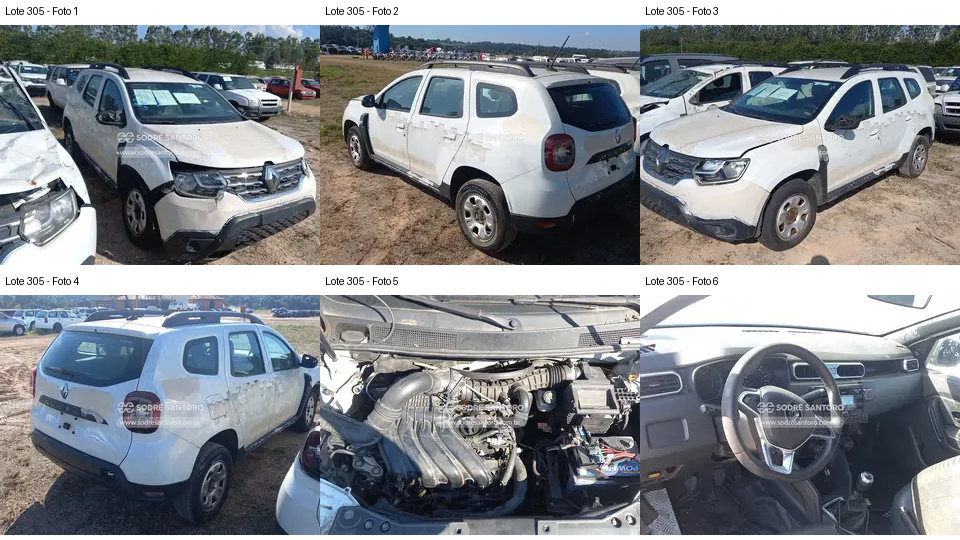

# Lote 0305 — edital 003/2026

Atualizado em: 2026-11-08. Classificação: hipótese/análise histórica e fatos voláteis do catálogo.
Fonte: comparacao_preliminar_carros.md, seção “Lote 0305”, linha 212; carros_conferencia.csv, registro Lote 0305.
Confiança: baixa para priorização/estado mecânico; conferência documental anterior não refeita integralmente.
Revalidar em: próxima consulta ao catálogo, antes da visita e antes de qualquer lance.
Veredito: grupo C de prioridade de vistoria; nenhuma aprovação de compra.
Custo total: não verificado. Valores abaixo são registros históricos, não cotação atual nem teto de lance.
Evidências: [galeria](../evidencias/305/galeria.png), [origens](../evidencias/305/fontes.json), [descrição](../evidencias/305/descricao.json).
Anexo I: [fonte](../fontes/md/Carros_lista.md), p. 7; conferir identidade no original.

## Análise anterior preservada

### Lote 0305 — Renault Duster Zen 1.6 — 21/22 — FWI8C71

**Grupo C. Avaria dianteira visível; alcance do impacto desconhecido.** Valor anotado no CSV: R$ 11.400,00 (Lance atual; sem atualização). Mínimo do Anexo I: R$ 11,400.00 (página 7 do PDF local).

- **Observado, carroceria/impactos:** F1/F3: para-choque dianteiro separado/desalinhado junto ao farol e para-lama; capô com folgas. Retrovisor aparece incompleto em vista lateral. F2/F4: resíduos na carroceria.
- **Observado, cofre:** F5: coletor, caixa de ar, tubulação principal e bateria aparecem presentes. Essa vista superior não exclui dano a radiador, suportes ou componentes inferiores.
- **Observado, interior:** F6: volante e console central presentes; há marcas nos bancos, sem resolução para classificar todo o desgaste.
- **Pendente/CSV:** A anotação de batida dianteira é compatível com as avarias visíveis; intensidade, direção e dano estrutural permanecem desconhecidos.
- **Foco da vistoria:** Priorizar comparação das folgas entre lados e observação de suportes, travessas acessíveis e fixações dos faróis. Pedir fotos próximas da região danificada e documentação de eventual reparo. Sem comprovação adicional, não assumir reparação limitada ao para-choque.

[Descrição e galeria consultadas](https://www.achalote.com/lote/sodresantoro/2814125) · [Endereço oficial referenciado](https://leilao.sodresantoro.com.br/leilao/29109/lote/2814125/)

## Próxima verificação
Confirmar identidade, documentação, condição observável e orçamento de reparos; atualizar apenas com fonte e data. Relatos do CSV não são diagnósticos. Não presumir testes de motor/manuseio permitidos.
