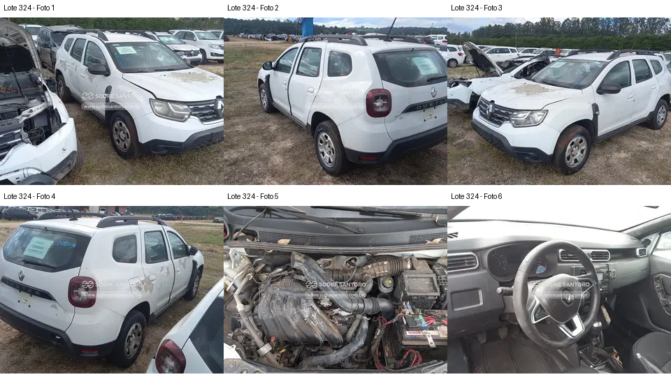

# Lote 0324 — edital 003/2026

Atualizado em: 2026-11-08. Classificação: hipótese/análise histórica e fatos voláteis do catálogo.
Fonte: comparacao_preliminar_carros.md, seção “Lote 0324”, linha 197; carros_conferencia.csv, registro Lote 0324.
Confiança: baixa para priorização/estado mecânico; conferência documental anterior não refeita integralmente.
Revalidar em: próxima consulta ao catálogo, antes da visita e antes de qualquer lance.
Veredito: grupo C de prioridade de vistoria; nenhuma aprovação de compra.
Custo total: não verificado. Valores abaixo são registros históricos, não cotação atual nem teto de lance.
Evidências: [galeria](../evidencias/324/galeria.png), [origens](../evidencias/324/fontes.json), [descrição](../evidencias/324/descricao.json).
Anexo I: [fonte](../fontes/md/Carros_lista.md), p. 7; conferir identidade no original.

## Análise anterior preservada

### Lote 0324 — Renault Duster Zen 1.6 — 21/22 — EMN8I06

**Grupo C. Relato de desmontagem não esclarecido pelas vistas disponíveis.** Valor anotado no CSV: R$ 18.100,00 (Lance inicial; sem atualização). Mínimo do Anexo I: R$ 18,100.00 (página 7 do PDF local).

- **Observado, carroceria/impactos:** F1–F4: resíduos nas laterais/tampa traseira; ópticas e para-choques presentes. Capô parcialmente elevado. Não há foto com porta aberta para confirmar desmontagem interna.
- **Observado, cofre:** F5: coletor e caixa de ar presentes; tubulações, conexões e região frontal precisam de fotos mais próximas. Aparência suja não comprova dano mecânico.
- **Observado, interior:** F6: volante, instrumentos e console central aparecem presentes, sem visão das faces internas de todas as portas.
- **Pendente/CSV:** “Motor partes desmontadas” e “porta desmontada” do CSV não têm extensão demonstrável nesta galeria; não é possível rejeitar nem validar integralmente o relato.
- **Foco da vistoria:** Pedir inventário escrito das peças removidas e imagens do cofre e da porta mencionada. Manter prioridade reduzida enquanto a desmontagem alegada permanecer sem esclarecimento, especialmente pelo valor anotado de R$ 18.100.

[Descrição e galeria consultadas](https://www.achalote.com/lote/sodresantoro/2814141) · [Endereço oficial referenciado](https://leilao.sodresantoro.com.br/leilao/29109/lote/2814141/)

## Próxima verificação
Confirmar identidade, documentação, condição observável e orçamento de reparos; atualizar apenas com fonte e data. Relatos do CSV não são diagnósticos. Não presumir testes de motor/manuseio permitidos.
