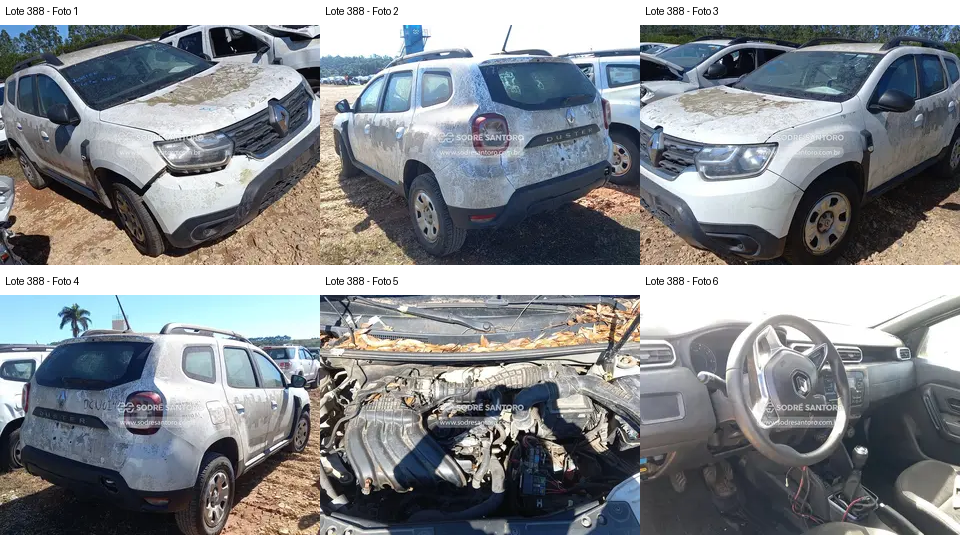

# Lote 0388 — edital 003/2026

Atualizado em: 2026-11-08. Classificação: hipótese/análise histórica e fatos voláteis do catálogo.
Fonte: comparacao_preliminar_carros.md, seção “Lote 0388”, linha 227; carros_conferencia.csv, registro Lote 0388.
Confiança: baixa para priorização/estado mecânico; conferência documental anterior não refeita integralmente.
Revalidar em: próxima consulta ao catálogo, antes da visita e antes de qualquer lance.
Veredito: grupo C de prioridade de vistoria; nenhuma aprovação de compra.
Custo total: não verificado. Valores abaixo são registros históricos, não cotação atual nem teto de lance.
Evidências: [galeria](../evidencias/388/galeria.png), [origens](../evidencias/388/fontes.json), [descrição](../evidencias/388/descricao.json).
Anexo I: [fonte](../fontes/md/Carros_lista.md), p. 8; conferir identidade no original.

## Análise anterior preservada

### Lote 0388 — Renault Duster Zen 1.6 — 20/21 — FUZ6B24

**Grupo C. Dano dianteiro e desmontagem elétrica aparente elevam as pendências.** Valor anotado no CSV: R$ 17.200,00 (Lance inicial; sem atualização). Mínimo do Anexo I: R$ 17,200.00 (página 8 do PDF local).

- **Observado, carroceria/impactos:** F1: para-choque separado/desalinhado junto ao farol de um lado; F1–F4: resíduos intensos nas superfícies.
- **Observado, cofre:** F5: folhas acumuladas e caixa/conjunto de admissão deslocado/aberto à direita da imagem; coletor presente. Não é possível avaliar ingresso de sujeira, corrosão interna ou causa da desmontagem.
- **Observado, interior:** F6: fiação exposta junto à parte inferior do painel/console; acabamento incompleto nessa região.
- **Pendente/CSV:** A falta de acabamento interno traseiro anotada no CSV não está mostrada, pois não há foto da área de carga. A extensão do impacto é desconhecida.
- **Foco da vistoria:** Pedir fotos da admissão, console e área de carga. Avaliar visualmente suportes dianteiros e inventariar componentes removidos. A soma de frente avariada e desmontagens torna menos atraente avançar sem esclarecimentos.

[Descrição e galeria consultadas](https://www.achalote.com/lote/sodresantoro/2814194) · [Endereço oficial referenciado](https://leilao.sodresantoro.com.br/leilao/29109/lote/2814194/)

## Próxima verificação
Confirmar identidade, documentação, condição observável e orçamento de reparos; atualizar apenas com fonte e data. Relatos do CSV não são diagnósticos. Não presumir testes de motor/manuseio permitidos.
