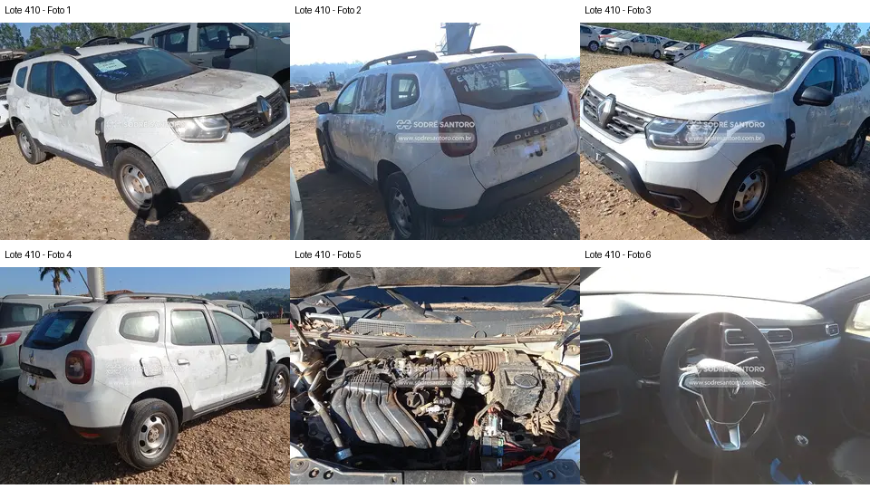

# Lote 0410 — edital 003/2026

Atualizado em: 2026-11-08. Classificação: hipótese/análise histórica e fatos voláteis do catálogo.
Fonte: comparacao_preliminar_carros.md, seção “Lote 0410”, linha 137; carros_conferencia.csv, registro Lote 0410.
Confiança: baixa para priorização/estado mecânico; conferência documental anterior não refeita integralmente.
Revalidar em: próxima consulta ao catálogo, antes da visita e antes de qualquer lance.
Veredito: grupo B de prioridade de vistoria; nenhuma aprovação de compra.
Custo total: não verificado. Valores abaixo são registros históricos, não cotação atual nem teto de lance.
Evidências: [galeria](../evidencias/410/galeria.png), [origens](../evidencias/410/fontes.json), [descrição](../evidencias/410/descricao.json).
Anexo I: [fonte](../fontes/md/Carros_lista.md), p. 9; conferir identidade no original.

## Análise anterior preservada

### Lote 0410 — Renault Duster Zen 1.6 — 20/21 — EUL2I52

**Grupo B. Admissão aparentemente desconectada e alegação de impacto exigem cautela.** Valor anotado no CSV: R$ 13.800,00 (Lance inicial; sem atualização). Mínimo do Anexo I: R$ 13,800.00 (página 9 do PDF local).

- **Observado, carroceria/impactos:** F1–F4: resíduos generalizados e marcas na carroceria; frente com capô parcialmente elevado. Não há elementos suficientes para qualificar uma colisão como “leve”.
- **Observado, cofre:** F5: há extremidade de tubulação aberta/desconectada na região dianteira esquerda da imagem. Coletor e parte da caixa de ar estão presentes; folhas/sujeira se acumulam na base do para-brisa. Estado interno e período de exposição são desconhecidos.
- **Observado, interior:** F6: volante, quadro de instrumentos e alavanca aparecem presentes, mas sombras impedem avaliar detalhes do console e do banco.
- **Pendente/CSV:** Ausência de estepe não é comprovada. A gravidade de “batida leve na frente” não pode ser validada. Tubulação fora de conexão é uma observação visual; contaminação interna é apenas possibilidade a investigar.
- **Foco da vistoria:** Pedir fotos próximas dos bocais e caminho da admissão; não tentar ligar o motor. Observar suportes dianteiros, fixações de faróis, folgas de capô e sinais de reparo acessíveis. Se não houver esclarecimento sobre a admissão aberta, manter reserva elevada para investigação posterior.

[Descrição e galeria consultadas](https://www.achalote.com/lote/sodresantoro/2814215) · [Endereço oficial referenciado](https://leilao.sodresantoro.com.br/leilao/29109/lote/2814215/)

## Próxima verificação
Confirmar identidade, documentação, condição observável e orçamento de reparos; atualizar apenas com fonte e data. Relatos do CSV não são diagnósticos. Não presumir testes de motor/manuseio permitidos.
