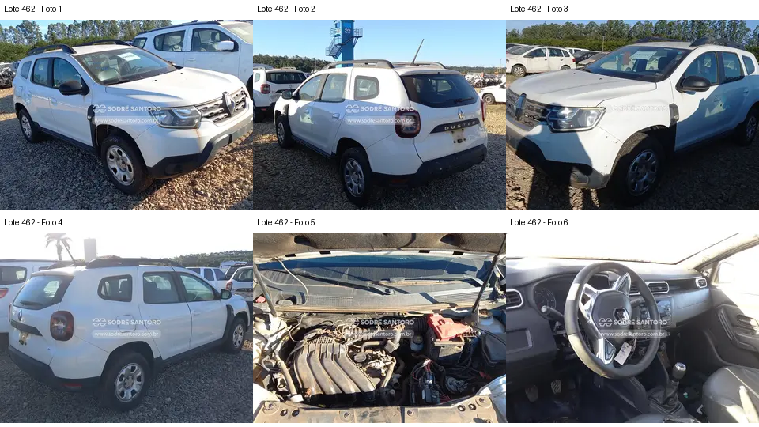

# Lote 0462 — edital 003/2026

Atualizado em: 2026-11-08. Classificação: hipótese/análise histórica e fatos voláteis do catálogo.
Fonte: comparacao_preliminar_carros.md, seção “Lote 0462”, linha 122; carros_conferencia.csv, registro Lote 0462.
Confiança: baixa para priorização/estado mecânico; conferência documental anterior não refeita integralmente.
Revalidar em: próxima consulta ao catálogo, antes da visita e antes de qualquer lance.
Veredito: grupo B de prioridade de vistoria; nenhuma aprovação de compra.
Custo total: não verificado. Valores abaixo são registros históricos, não cotação atual nem teto de lance.
Evidências: [galeria](../evidencias/462/galeria.png), [origens](../evidencias/462/fontes.json), [descrição](../evidencias/462/descricao.json).
Anexo I: [fonte](../fontes/md/Carros_lista.md), p. 10; conferir identidade no original.

## Análise anterior preservada

### Lote 0462 — Renault Duster Zen 1.6 — 20/21 — FVH7J25

**Grupo B. Exterior relativamente completo, com desmontagem evidente na região do volante.** Valor anotado no CSV: R$ 14.000,00 (Lance inicial; sem atualização). Mínimo do Anexo I: R$ 14,000.00 (página 10 do PDF local).

- **Observado, carroceria/impactos:** F1–F4: carroceria, conjuntos ópticos e para-choques aparecem montados; marcas/resíduos nas laterais. A foto não permite concluir ausência de para-lama metálico ou de revestimento da caixa de roda.
- **Observado, cofre:** F5: coletor e duto superior são visíveis; caixa de ar com região aberta e peça/tampa deslocada na área superior direita. Componente compatível com bateria aparece na parte inferior.
- **Observado, interior:** F6: acabamento/parte central do volante está deslocado e com região interna aparente. Não é possível concluir se o módulo de airbag foi removido ou acionado.
- **Pendente/CSV:** Rasgo de banco, falta de bateria e “sem paralama” do CSV precisam de confirmação específica. Distinguir para-lama externo de parabarro interno.
- **Foco da vistoria:** Priorizar foto nítida do volante e inventário do conjunto de segurança por profissional, dentro do acesso permitido. Pedir fotos da caixa de roda e bancos. A aparência externa favorável não resolve a dúvida sobre o volante.

[Descrição e galeria consultadas](https://www.achalote.com/lote/sodresantoro/2814264) · [Endereço oficial referenciado](https://leilao.sodresantoro.com.br/leilao/29109/lote/2814264/)

## Próxima verificação
Confirmar identidade, documentação, condição observável e orçamento de reparos; atualizar apenas com fonte e data. Relatos do CSV não são diagnósticos. Não presumir testes de motor/manuseio permitidos.
