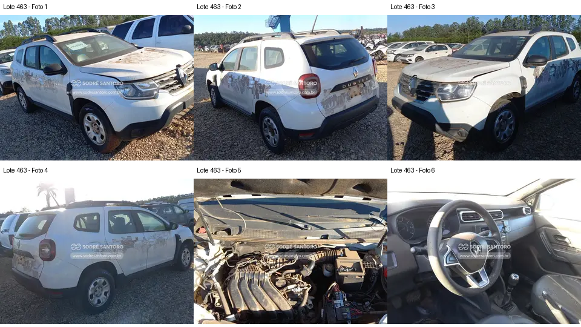

# Lote 0463 — edital 003/2026

Atualizado em: 2026-11-08. Classificação: hipótese/análise histórica e fatos voláteis do catálogo.
Fonte: comparacao_preliminar_carros.md, seção “Lote 0463”, linha 92; carros_conferencia.csv, registro Lote 0463.
Confiança: baixa para priorização/estado mecânico; conferência documental anterior não refeita integralmente.
Revalidar em: próxima consulta ao catálogo, antes da visita e antes de qualquer lance.
Veredito: grupo A de prioridade de vistoria; nenhuma aprovação de compra.
Custo total: não verificado. Valores abaixo são registros históricos, não cotação atual nem teto de lance.
Evidências: [galeria](../evidencias/463/galeria.png), [origens](../evidencias/463/fontes.json), [descrição](../evidencias/463/descricao.json).
Anexo I: [fonte](../fontes/md/Carros_lista.md), p. 10; conferir identidade no original.

## Análise anterior preservada

### Lote 0463 — Renault Duster Zen 1.6 — 20/21 — FPV3D79

**Grupo A. Conjunto visual razoavelmente completo; pendência de piso e acabamento do cofre.** Valor anotado no CSV: R$ 18.100,00 (Lance inicial; sem atualização). Mínimo do Anexo I: R$ 18,100.00 (página 10 do PDF local).

- **Observado, carroceria/impactos:** F1–F4: ópticas, para-choques e retrovisores aparecem instalados. Há resíduos extensos nas portas e traseira e capô parcialmente elevado nas fotos; não é prova de colisão.
- **Observado, cofre:** F5: coletor e duto superior aparecem presentes. A caixa de ar mostra região aberta/incompleta, que exige foto melhor. Na parte inferior direita há componente retangular com aspecto de bateria; a imagem não sustenta afirmar ausência na data da foto.
- **Observado, interior:** F6: volante, instrumentos, console central e alavanca aparecem presentes. Não há visão suficiente do piso nem dos bancos completos.
- **Pendente/CSV:** Furo no assoalho não é visível. “Sem bateria” do CSV diverge da aparência da foto; além disso, o edital prevê remoção de baterias para visitação. A presença em foto antiga não garante entrega com bateria.
- **Foco da vistoria:** Pedir foto detalhada da caixa de ar e do ponto referido como furo no piso; conferir se é passagem de equipamento, dano, corrosão ou outra abertura, sem antecipar a causa. Verificar visualmente o painel e assoalho acessível. Não tratar como candidato de baixo risco apenas pela aparência externa.

[Descrição e galeria consultadas](https://www.achalote.com/lote/sodresantoro/2814265) · [Endereço oficial referenciado](https://leilao.sodresantoro.com.br/leilao/29109/lote/2814265/)

## Próxima verificação
Confirmar identidade, documentação, condição observável e orçamento de reparos; atualizar apenas com fonte e data. Relatos do CSV não são diagnósticos. Não presumir testes de motor/manuseio permitidos.
