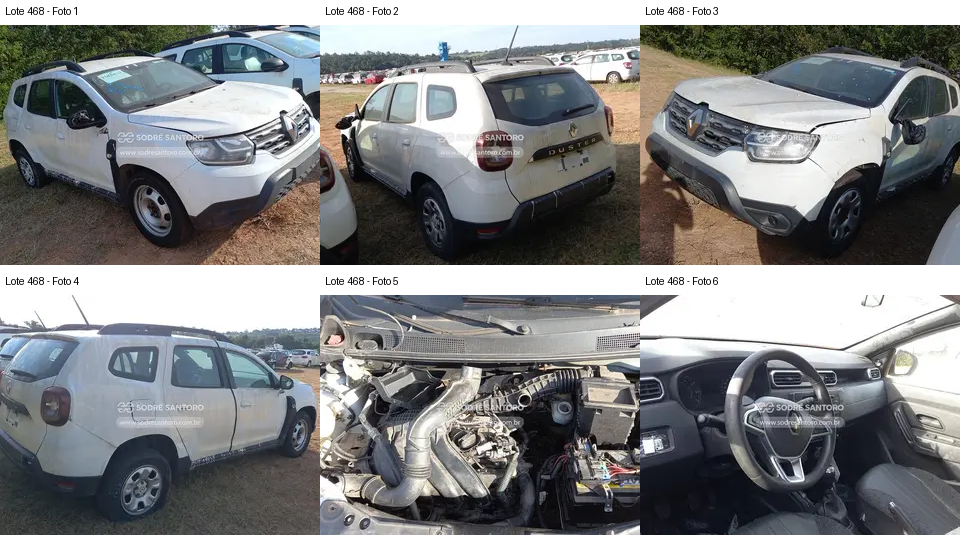

# Lote 0468 — edital 003/2026

Atualizado em: 2026-11-08. Classificação: hipótese/análise histórica e fatos voláteis do catálogo.
Fonte: comparacao_preliminar_carros.md, seção “Lote 0468”, linha 107; carros_conferencia.csv, registro Lote 0468.
Confiança: baixa para priorização/estado mecânico; conferência documental anterior não refeita integralmente.
Revalidar em: próxima consulta ao catálogo, antes da visita e antes de qualquer lance.
Veredito: grupo B de prioridade de vistoria; nenhuma aprovação de compra.
Custo total: não verificado. Valores abaixo são registros históricos, não cotação atual nem teto de lance.
Evidências: [galeria](../evidencias/468/galeria.png), [origens](../evidencias/468/fontes.json), [descrição](../evidencias/468/descricao.json).
Anexo I: [fonte](../fontes/md/Carros_lista.md), p. 10; conferir identidade no original.

## Análise anterior preservada

### Lote 0468 — Renault Duster Zen 1.6 — 20/21 — FNE0H17

**Grupo B. Danos em retrovisores e aberturas de painel aumentam a lista de reposição.** Valor anotado no CSV: R$ 12.900,00 (Lance inicial; sem atualização). Mínimo do Anexo I: R$ 12,900.00 (página 10 do PDF local).

- **Observado, carroceria/impactos:** F1 e F3: retrovisores aparecem danificados/incompletos, com partes expostas. F1–F4: painéis externos e ópticas principais aparecem presentes, com marcas/resíduos; capô parcialmente elevado.
- **Observado, cofre:** F5: coletor, tubulação de admissão e componente compatível com bateria são visíveis. Algumas caixas/áreas do cofre parecem abertas; não é possível definir inventário nem atribuir falha de motor.
- **Observado, interior:** F6: há abertura retangular no painel e componentes/fiação aparentes nessa região. O volante e a alavanca aparecem presentes.
- **Pendente/CSV:** Rasgo no banco não é confirmável neste recorte. “Painel com furos” deve ser discriminado entre abertura de acabamento/equipamento e perfuração real; a foto não resolve essa diferença em todos os pontos.
- **Foco da vistoria:** Orçar os conjuntos completos dos retrovisores e acabamentos apenas após inventário presencial permitido. Pedir fotos nítidas de bancos e painel; conferir presença de comandos e conectores sem tocar. Não concluir que airbags estão ausentes ou acionados pela abertura do painel.

[Descrição e galeria consultadas](https://www.achalote.com/lote/sodresantoro/2814270) · [Endereço oficial referenciado](https://leilao.sodresantoro.com.br/leilao/29109/lote/2814270/)

## Próxima verificação
Confirmar identidade, documentação, condição observável e orçamento de reparos; atualizar apenas com fonte e data. Relatos do CSV não são diagnósticos. Não presumir testes de motor/manuseio permitidos.
