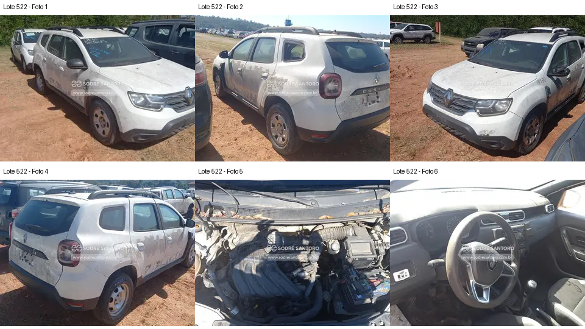

# Lote 0522 — edital 003/2026

Atualizado em: 2026-11-08. Classificação: hipótese/análise histórica e fatos voláteis do catálogo.
Fonte: comparacao_preliminar_carros.md, seção “Lote 0522”, linha 77; carros_conferencia.csv, registro Lote 0522.
Confiança: baixa para priorização/estado mecânico; conferência documental anterior não refeita integralmente.
Revalidar em: próxima consulta ao catálogo, antes da visita e antes de qualquer lance.
Veredito: grupo A de prioridade de vistoria; nenhuma aprovação de compra.
Custo total: não verificado. Valores abaixo são registros históricos, não cotação atual nem teto de lance.
Evidências: [galeria](../evidencias/522/galeria.png), [origens](../evidencias/522/fontes.json), [descrição](../evidencias/522/descricao.json).
Anexo I: [fonte](../fontes/md/Carros_lista.md), p. 11; conferir identidade no original.

## Análise anterior preservada

### Lote 0522 — Renault Duster Zen 1.6 — 20/21 — GBP5D07

**Grupo A. Alternativa visual aos primeiros colocados, com acabamentos a conferir.** Valor anotado no CSV: R$ 13.500,00 (Lance inicial; sem atualização). Mínimo do Anexo I: R$ 13,500.00 (página 11 do PDF local).

- **Observado, carroceria/impactos:** F1–F4: conjuntos ópticos e para-choques aparecem montados; há resíduos extensos de identificação nas laterais e tampa traseira e marcas no para-choque dianteiro.
- **Observado, cofre:** F5: coletor, caixa de ar e duto principal aparecem presentes; há bateria visível na fotografia. Folhas na região da base do para-brisa. Isso não informa o estado interno do motor.
- **Observado, interior:** F6: há uma abertura retangular no painel, à esquerda da região central inferior; console/controles centrais parecem incompletos. Não é possível inventariar precisamente as peças nem concluir sobre airbags.
- **Pendente/CSV:** “Banco rasgado” não fica demonstrado pelo recorte disponível. “Painel aberto” é parcialmente sustentado pela abertura visível, sem dimensionar toda a desmontagem.
- **Foco da vistoria:** Conferir placa GBP5D07 e lote 0522 antes de qualquer decisão. Pedir fotos frontais do painel e de todos os bancos. Inventariar molduras, comandos e conectores visíveis, verificar sinais de água e avaliar carroceria sob resíduos. Link corrigido e identidade documental conferida.

[Descrição e galeria consultadas](https://www.achalote.com/lote/sodresantoro/2814317) · [Endereço oficial referenciado](https://leilao.sodresantoro.com.br/leilao/29109/lote/2814317/)

## Próxima verificação
Confirmar identidade, documentação, condição observável e orçamento de reparos; atualizar apenas com fonte e data. Relatos do CSV não são diagnósticos. Não presumir testes de motor/manuseio permitidos.
