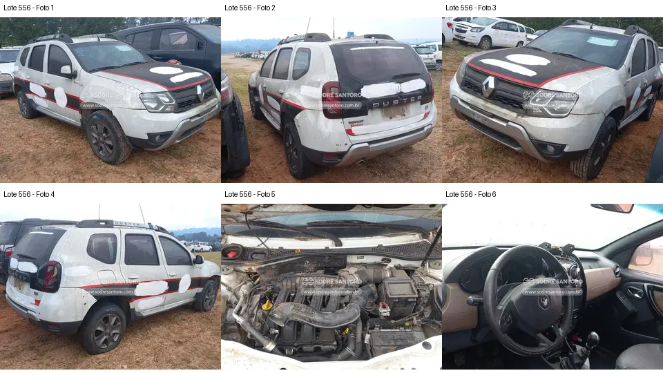

# Lote 0556 — edital 003/2026

Atualizado em: 2026-11-08. Classificação: hipótese/análise histórica e fatos voláteis do catálogo.
Fonte: comparacao_preliminar_carros.md, seção “Lote 0556”, linha 182; carros_conferencia.csv, registro Lote 0556.
Confiança: baixa para priorização/estado mecânico; conferência documental anterior não refeita integralmente.
Revalidar em: próxima consulta ao catálogo, antes da visita e antes de qualquer lance.
Veredito: grupo B de prioridade de vistoria; nenhuma aprovação de compra.
Custo total: não verificado. Valores abaixo são registros históricos, não cotação atual nem teto de lance.
Evidências: [galeria](../evidencias/556/galeria.png), [origens](../evidencias/556/fontes.json), [descrição](../evidencias/556/descricao.json).
Anexo I: [fonte](../fontes/md/Carros_lista.md), p. 11; conferir identidade no original.

## Análise anterior preservada

### Lote 0556 — Renault Duster 2.0 D 4x4 — 16/16 — FYL0042

**Grupo B. Interior aberto e maior complexidade do 4x4; acabamento aparente não indica conservação mecânica.** Valor anotado no CSV: R$ 15.100,00 (Lance inicial; sem atualização). Mínimo do Anexo I: R$ 15,100.00 (página 11 do PDF local).

- **Observado, carroceria/impactos:** F1–F4: adesivação e resíduos extensos; para-choques e ópticas presentes. A galeria não permite confirmar de modo seguro a falta de retrovisor indicada no CSV.
- **Observado, cofre:** F5: coletor e caixa de ar aparecem instalados, com sujeira. A parte inferior e o escapamento não estão fotografados.
- **Observado, interior:** F6: painel central aberto/desmontado e fiação aparente; revestimento em tom caramelo visível em parte do interior. Material do revestimento e estado completo dos bancos não são verificáveis.
- **Pendente/CSV:** Escapamento enferrujado é relato do CSV, sem imagem correspondente. Não há teste da tração 4x4 nem comprovação de saúde mecânica.
- **Foco da vistoria:** Conferir painel, retrovisores e bancos e pedir fotografias inferiores já disponíveis. Considerar orçamento específico de transmissão 4x4 e escapamento após verificação permitida. Não premiar o veículo apenas pelo revestimento aparente.

[Descrição e galeria consultadas](https://www.achalote.com/lote/sodresantoro/2814346) · [Endereço oficial referenciado](https://leilao.sodresantoro.com.br/leilao/29109/lote/2814346/)

## Próxima verificação
Confirmar identidade, documentação, condição observável e orçamento de reparos; atualizar apenas com fonte e data. Relatos do CSV não são diagnósticos. Não presumir testes de motor/manuseio permitidos.
